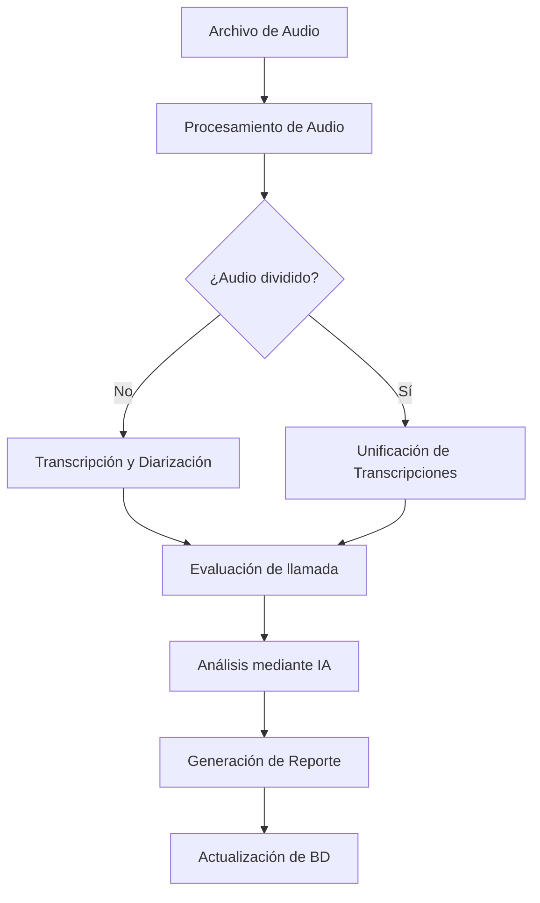

# Módulo MOD_BOT SINDYBOT - Documentación

## Descripción General

El módulo `mod_bot` es el componente central del sistema SINDYBOT encargado del procesamiento, análisis y auditoría automatizada de llamadas telefónicas. Implementa la lógica principal para la transcripción de audio, diarización (identificación de hablantes), evaluación de adherencia a guiones, validación de tarifas y generación de reportes de auditoría usando IA.

## Diagrama de Flujo del Sistema



## Estructura de Archivos

El módulo `mod_bot` contiene los siguientes archivos y subdirectorios principales:

```
mod_bot/
│
├── data/                    # Directorio con datos de referencia
│   └── raw/                 # Datos sin procesar
│       ├── guionV2.json     # Guiones de ventas para diferentes productos
│       └── tarifasV2.json   # Tarifas y montos de indemnización
│
├── diccionary/              # Diccionario para corrección de textos
│   └── diccionary.txt
│
├── l_process/               # Procesos lógicos centrales
│   ├── stt_provider.py      # Entrada STT (STT_PROVIDER); usar desde diariza/unified
│   ├── audio_processing.py  # Backend WhisperX (solo vía stt_provider)
│   ├── call_evaluation.py   # Evaluación de llamadas y criterios
│   ├── detection.py         # Detección de aceptaciones y rechazos
│   ├── file_utils.py        # Utilidades para manejo de archivos
│   ├── logger_config.py     # Configuración de logging
│   ├── text_processing.py   # Procesamiento de textos transcritos
│   └── unified_processing.py # Procesamiento de llamadas divididas
│
├── logic_utils/             # Utilidades lógicas auxiliares
│   └── get_tags.py          # Extracción de metadatos de archivos
│
├── tools/                   # Herramientas de soporte
│   ├── db_manager.py        # Gestión de conexiones a BD
│   ├── db_services/         # Servicios de base de datos
│   │   ├── db_logger.py     # Logging de operaciones en BD
│   │   └── db_query_module.py # Módulo de consultas SQL
│   ├── diccionario_manager.py # Gestión de diccionario
│   ├── diccionario_utils.py # Utilidades para corrección
│   └── import_dictionary.py # Importación de diccionarios
│
├── data_updateBD.py         # Actualización de datos en BD
├── diariza.py               # Script para diarización independiente
├── loading.py               # Carga de recursos y modelos
├── logical.py               # Lógica central del sistema
└── readme.md                # Documentación general
```

## Componentes Principales

### 1. STT y procesamiento de audio

**Entrada:** `l_process/stt_provider.py` → `procesar_audio_via_provider()` (variable `STT_PROVIDER`).

**Backend WhisperX (default):** `l_process/audio_processing.py` — no importar `procesar_audio()` desde otros módulos.

**Funcionalidades principales:**
- `procesar_audio_via_provider()`: transcribe según proveedor configurado.
- `procesar_audio()`: implementación WhisperX (interna).
- `analizar_hablantes()`: estadísticas por hablante a partir de `result["segments"]`.

**Flujo de procesamiento:**
1. Carga el modelo de WhisperX
2. Realiza la transcripción del audio a texto
3. Alinea el texto con el audio
4. Realiza la diarización para identificar hablantes
5. Genera un texto diarizado con marcas de tiempo
6. Analiza estadísticas como tiempo de habla por hablante e interrupciones

### 2. Evaluación de Llamadas (`l_process/call_evaluation.py`)

Este componente implementa la lógica para evaluar la calidad de una llamada según criterios predefinidos.

**Funcionalidades principales:**
- `evaluar_llamada()`: Evalúa una transcripción según criterios como aceptaciones, adherencia al guion y validación de tarifas.
- `process_call()`: Procesa una llamada completa y genera el reporte de auditoría.

**Sistema de puntuación:**
- **Criterios críticos** (50% del peso): aceptación del cliente, mención de tarifas correctas, indemnizaciones.
- **Adherencia al guion** (30% del peso): saludo, explicación, validación, cierre.
- **Factores negativos** (20% del peso): rechazos explícitos, dudas no resueltas, información incorrecta.

La calificación final determina si la llamada se considera "POSITIVA" o "NEGATIVA" para efectos de ventas.

### 3. Detección de Elementos (`l_process/detection.py`)

Implementa algoritmos para detectar elementos críticos en la transcripción de la llamada.

**Funcionalidades principales:**
- `detectar_aceptacion()`: Identifica frases de aceptación y rechazo en la transcripción.
- `extract_names()`: Extrae nombres de asesor y cliente.
- `extraer_calificacion()`: Analiza el reporte para extraer la calificación final.

**Proceso de detección:**
1. Analiza el texto en busca de patrones de aceptación ("sí", "claro", "de acuerdo")
2. Identifica rechazos explícitos ("no", "no me interesa")
3. Extrae el contexto de cada aceptación o rechazo para evaluación
4. Contabiliza el número total de aceptaciones y rechazos

### 4. Procesamiento Unificado (`l_process/unified_processing.py`)

Este componente maneja el procesamiento de llamadas divididas en múltiples archivos.

**Funcionalidades principales:**
- `procesar_audio_dividido()`: Procesa un grupo de archivos de audio pertenecientes a la misma llamada.
- Define las rutas y directorios para los diferentes tipos de archivos generados.

**Proceso de unificación:**
1. Procesa cada parte de la llamada individualmente
2. Unifica las transcripciones en un solo texto coherente
3. Almacena el resultado unificado en `uni_files_audito`
4. Procesa el texto unificado como una llamada única

### 5. Actualización de Base de Datos (`data_updateBD.py`)

Maneja la interacción con la base de datos para almacenar resultados y actualizar estados.

**Funcionalidades principales:**
- `guardar_resultado_auditoria()`: Almacena el texto completo del reporte de auditoría.
- `actualizar_estado_venta()`: Actualiza el estado de una venta (POSITIVA/NEGATIVA) en la base de datos.
- `insertar_datos_aprendizaje()`: Guarda datos para mejorar el sistema de evaluación.
- `obtener_datos_aprendizaje()`: Recupera datos históricos para análisis.

### 6. Lógica General (`logical.py`)

Archivo central que conecta los diferentes componentes del sistema.

**Funcionalidades principales:**
- Definición de flujos de procesamiento
- Integración de los diferentes módulos
- Punto de entrada para el procesamiento completo

### 7. Utilidades para Tags (`logic_utils/get_tags.py`)

Extrae metadatos a partir de los nombres de archivos de audio.

**Funcionalidades principales:**
- `obtener_gasera_seguro()`: Analiza el nombre del archivo para extraer información como gasera, número de contrato, fecha y tipo de seguro.

### 8. Herramientas de Base de Datos (`tools/db_manager.py` y subdirectorio `tools/db_services/`)

Conjunto de herramientas para la gestión de la base de datos.

**Funcionalidades principales:**
- Establecimiento de conexiones a la base de datos
- Ejecución de consultas SQL
- Logging de operaciones en la base de datos
- Funciones específicas para actualización y consulta de datos

### 9. Manejo de Diccionario (`tools/diccionario_manager.py` y `tools/diccionario_utils.py`)

Herramientas para la corrección ortográfica y manejo del diccionario personalizado.

**Funcionalidades principales:**
- Carga y gestión del diccionario
- Corrección de textos transcritos
- Mejora de la calidad de las transcripciones

## Flujo del Proceso Completo

1. **Entrada de Archivos**:
   - Se recibe un archivo de audio (.gsm) para procesar
   - Se extrae información del nombre del archivo (gasera, contrato, etc.)

2. **Procesamiento de Audio**:
   - Se determina si es una llamada única o dividida
   - Se realiza la transcripción y diarización con WhisperX
   - Se almacena el texto en `log_audio_to_text` o se unifica en `uni_files_audito`

3. **Evaluación de Llamada**:
   - Se cargan los datos de referencia (guiones y tarifas)
   - Se analizan las aceptaciones, adherencia al guion y tarifas mencionadas
   - Se construye un prompt detallado para el modelo de IA

4. **Análisis con IA**:
   - Se procesa el prompt con Google Gemini (`GEMINI_API_KEY` en `.env`)
   - Se genera un análisis detallado y estructurado
   - Se extrae la calificación final (POSITIVA/NEGATIVA)

5. **Resultados y Almacenamiento**:
   - Se actualiza el estado de la venta en la base de datos
   - Se almacena el reporte completo en `Log_sales_audito`
   - Se guardan datos para aprendizaje y mejora continua

## Uso de Archivos de Datos

### 1. Guiones (`data/raw/guionV2.json`)

Contiene los guiones específicos para cada tipo de producto y gasera. Se utilizan para evaluar la adherencia del asesor al guion establecido.

Estructura:
```json
{
  "PRODUCTO_1": {
    "gasera_1": {
      "introduccion": "...",
      "presentacion": "...",
      "cierre": "..."
    }
  }
}
```

### 2. Tarifas (`data/raw/tarifasV2.json`)

Define las tarifas oficiales para cada producto y gasera. Se usa para verificar que los montos mencionados durante la llamada sean correctos.

Estructura:
```json
{
  "PRODUCTO_1": {
    "gasera_1": {
      "tarifa": 9999,
      "indemnizacion": 9999999
    }
  }
}
```

## Notas de Integración

- El sistema se integra con una base de datos MySQL para el almacenamiento persistente de resultados.
- Los resultados de la auditoría se pueden consultar a través de la interfaz web de SINDYBOT.
- El directorio `whisperX` contiene una implementación modificada de WhisperX adaptada específicamente para los requisitos de SINDYBOT.

## Manejo de Errores

El sistema implementa un robusto manejo de errores:

1. **Logging**: Todos los errores se registran en `auditoria.log`
2. **Reintentos**: Para operaciones críticas (como el procesamiento con IA), se implementan mecanismos de reintento
3. **Validación**: Se realizan validaciones en cada etapa para garantizar la integridad de los datos

## Escalabilidad

El sistema está diseñado para manejar un volumen considerable de llamadas:

- Procesamiento en lotes para múltiples archivos
- Liberación de memoria después de cada procesamiento
- Optimización del uso de GPU para el modelo WhisperX
- Mecanismos para evitar la sobrecarga de la base de datos

---

*Para más información sobre las capacidades específicas o para consultar la documentación del directorio `whisperX`, por favor consulte la documentación correspondiente.*
